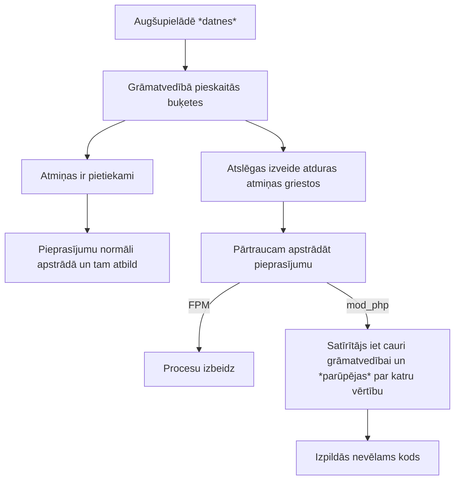
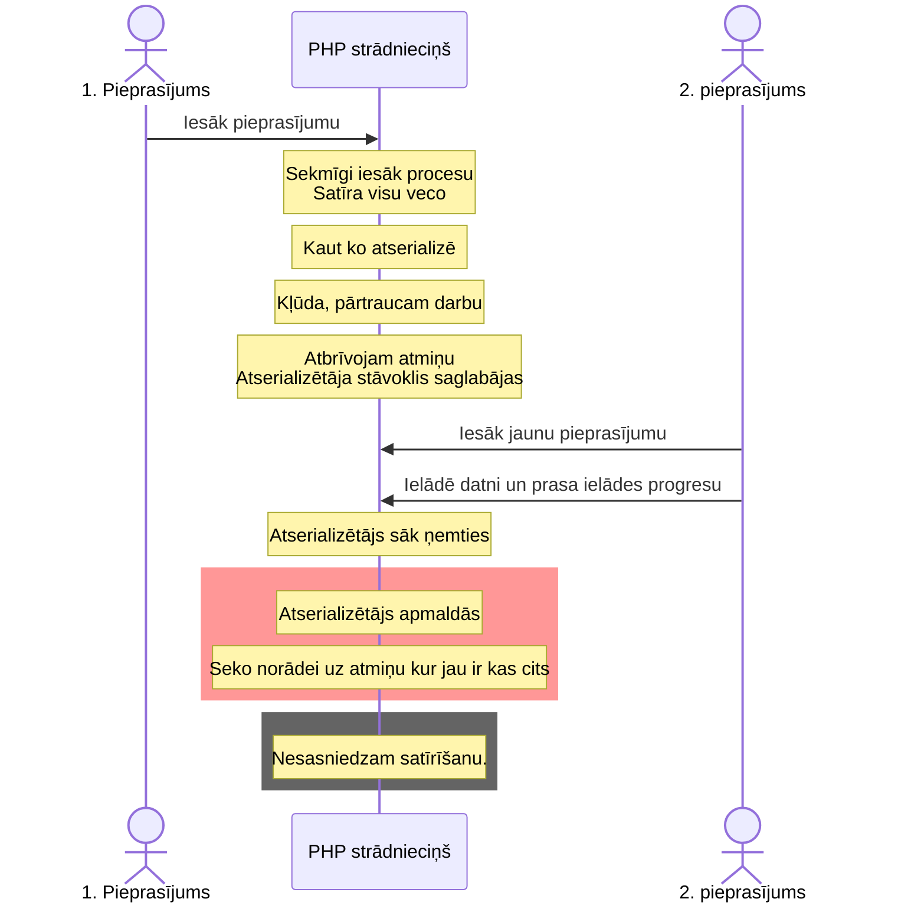

# php2shell

2026. gada 21. novembrī tika [izziņotas](https://www.php.net/archive/2026.php#2026-10-21-5)
PHP ievainojamības un izlaisti to labojumi.

Daudz kas tika izslēgts. Un daudz kas nestrādāja.

## Ievainojamības

| | [CVE-2026-109618](https://github.com/php/php-src/security/advisories/GHSA-w8hw-w9fx-j79w) | [CVE-2026-109619](https://github.com/php/php-src/security/advisories/GHSA-6wmf-4rv5-p3rp) |
|-------:|------|-------------|
| nosaukums | RCE via OOM corruption | RCE via stale global state |
| uzbrukumi skar | Apache + mod_php | mod_php, PHP-FPM |
| izmantojamība | noklusējuma konfigurācija <br> neatkarīgi no koda | atkarībā no koda |

> [!NOTE]
> FrankenPHP, LSAPI — nav zināms (ir pamats aizdomām).

### RCE via OOM corruption

- **Pieņēmums:** Visas zināmās struktūras ir "gatavas" un drošas.
- **Kļūda**: Beidzoties atmiņai darbu pārtrauc pusratā.
- **Problēma**: Atmiņas satīrītājs nejauši izpilda kodu.

Uzbrukumu ieskicēsim pēc Calif [raksta](https://calif.io/php2shell/).
PHP masīva

```php
[
    'vārds' => 'Pēteris',
    'uzvārds' => 'Paraugs',
    'adrese' => [
        'iela' => 'Piemēra iela',
        'pilsēta' => 'R1ga',
    ],
    'pazīmes' => [
        'pieklājīgs',
        'pacietīgs',
    ],
];
```

elementi [tiek glabāti](https://github.com/php/php-src/blob/82b01e22298a49033f4c651ed60a73b7bb4986c9/Zend/zend_types.h#L386-L418) šādās C buķetēs:

```c
typedef struct _Bucket {
	zval              val;
	zend_ulong        h;                /* hash value (or numeric index)   */
	zend_string      *key;              /* string key or NULL for numerics */
} Bucket;
```

bet [veidojot tās](https://github.com/php/php-src/blob/82b01e22298a49033f4c651ed60a73b7bb4986c9/Zend/zend_hash.c#L1064) varēja pārtrūkt darbs:

```php
// https://calif.io/php2shell/#but-what-does-an-oom-buy-you-really
idx = ht->nNumUsed++;
ht->nNumOfElements++;

p = ht->arData + idx;
p->key = zend_string_init(str, len, persistent); /* may zend_bailout() */

p->h = ZSTR_H(p->key) = h;
ZVAL_COPY_VALUE(&p->val, pData);
```

`p->key` un `p->val` paliek nesagatavoti — kas tur iekšā?

Bet grāmatvedībā (`nNumUsed`, `nNumOfElements`) jau pieskaitīts un satīrītājs ķersies klāt — tur tad arī var notikt nevēlama koda izpilde, ja buķetei iedalītajā vietā ir palikuši baiti, kurus satīrītājs interpretēs kā kaut ko izpildāmu. (Kāpēc? Kā tur dabūt tādus baitus?)

**Kā pārsniedz atmiņu?** No [paziņojuma](https://github.com/php/php-src/security/advisories/GHSA-w8hw-w9fx-j79w):

- A multipart request without a usable declared content length may pass the initial `post_max_size` check and continue supplying decoded body data. [**IZLABOTS**](https://github.com/php/php-src/commit/3584a98bda0f2c0d367255b046798b0d3a221a19#diff-81d659aa9e83177ac08151f99cebf21ab331d22462c72a1039f59947e66f5a35R249-R252)
- A multipart part can contain an unrestricted number of headers. Representing these headers inside PHP can use substantially more memory than their wire representation, allowing a request within `post_max_size` to exhaust the normal `memory_limit`. [**IZLABOTS**](https://github.com/php/php-src/commit/3584a98bda0f2c0d367255b046798b0d3a221a19#diff-81d659aa9e83177ac08151f99cebf21ab331d22462c72a1039f59947e66f5a35R400-R457)
- Empty file controls do not count towards `max_file_uploads` but still create the normal file metadata arrays. Nested field names multiply the generated array work.

Piemēram, lauka `pacients[316][adrese][iela]` iesūtīšana aizņem atmiņu ar struktūru:

```php
[
    'pacients' => [
        316 => [
            'adrese' => [
                'iela' => /* ..... */,
            ],
        ],
    ],
];
```

Kopsavelkot:



> [!CAUTION]
> **Kļūda** bija visiem (ir **IZLABOTA**), bet izmantojamība atrasta tikai mod_php. Atkarīga no konfigurācijas, paplašinājumiem.

> [!TIP]
> Tāpēc drošāk ir neizpaust info par serveri (versijas, `phpinfo()`).

### RCE via stale global state

- **Pieņēmums:** Jaunā pieprasījumā sākam visu no baltas lapas.
- **Kļūda**: Balto lapu izveido pēc tam, kad sākuma jautājumi apstrādāti.
- **Problēma**: Datu atserializētājs saglabājis vecu grāmatvedību un apstrādā nepareizos datus.


Pēc [Calif raksta](https://calif.io/php2shell/#but-what-about-fpm-or-a-gift-from-an-old-friend):

Atserializētājs uzskaita, kur atrodas. Ja ir iekšā apakšuzdevumā (`level` ir lielāks par 0), tad izmanto apkārtējo info kontekstu.

```php
/* php_var_unserialize_init(), abbreviated */

if (BG(serialize_lock) || !BG(unserialize).level) {
    d = emalloc(sizeof(struct php_unserialize_data));

    /* Initialize the reference and destructor lists. */
    /* ... */

    if (!BG(serialize_lock)) {
        BG(unserialize).data = d;
        BG(unserialize).level = 1;
    }
} else {
    d = BG(unserialize).data;
    ++BG(unserialize).level;
}
```

Bet, ja atmiņa beidzas, tad šis stāvoklis netiek satīrīts un nākamais serializētājs no `level` *domā*, ka ir iekšā apakšuzdevumā un izmanto apkārtējo kontekstu. Kaut gan tie dati jau bija atmesti un varbūt atmiņa jau ir pārrakstīta ar ko citu.

Izmantojamība ir atkarīga no koda, bet:

> In phpMyAdmin, a normal `session_start()` loads a Session record that we previously built through HTTP requests. WordPress reaches the same generic decoder through ordinary `maybe_unserialize()` calls. By controlling the memory pressure around those operations, we can let the decoder build useful reference and destructor lists before a later allocation hits `memory_limit`.



> [!CAUTION]
> Šis ir viens piemērs. Netrūkst citu veido, kā sasniegt *veco* stāvokli: https://github.com/php/php-src/security/advisories/GHSA-6wmf-4rv5-p3rp

> [!IMPORTANT]
> Jātrāpa divus secīgus pieprasījumus pa to pašu strādnieku.

Labojums: [satīrīt laicīgāk](https://github.com/php/php-src/commit/3584a98bda0f2c0d367255b046798b0d3a221a19#diff-2b0486443df74cd919c949f33f895eacf97c34b8490e7554e032e770ab11e4d8R505)

### Vēl viena ievainojamība pēc labojumiem????

https://www.php.net/archive/2026.php#2026-10-23-1 

## Hronoloģija

Publiski redzamā:

- 20. oktobris: baumas
- 20. oktobrī 19:32 [paziņojums](https://externals.io/message/132883), arī [general listē](https://news-web.php.net/php.general/start/328870): rīt 17:00 (14:00 UTC) gatavojamies
- tiek pārpublicēts redīsā, čivēklī u.c.
- Izlaists [video](https://x.com/k_firsov/status/2112641845926989944)
- 21. oktobrī 05:21 [Gina](https://phpc.social/@Girgias/117476510850918355):
> if you can afford turning of a server for a day, that might be the most sensible thing to do
- 21. oktobrī 10:41 pampāļi chainguard publicē labojumu
- 21. oktobrī 14:06 CERT brīdina gatavoties uz 17:00
- 21. oktobrī ap 17:00 [publicē labojumus un iztirzājumus](https://www.php.net/archive/2026.php#2026-10-21-5)

## Ko tas saka par PHP?

- Izstrādātāji nopietni izturas pret drošību
- Lietotāji arī
- PHP ir interneta darba zirgs

Citas ievainojamības šais dienās:


## Ko vajadzēja darīt?

1. Redzēt brīdinājumu, sagatavoties
2. Izvērtēt riskus un variantus, varbūt atslēgt serverus
3. 21. oktobrī 17:00 iepazīties ar publicētajiem paziņojumiem
4. Apdeitoties vai domāt citus risinājumus
5. Izmantot rezerves variantus apdeitošanai...

## Grūtības atjaunot?

- veci projekti, PHP zem 8.2, īpaši zem 7.4
- debian / ubuntu
- redhat / centos --- https://phpc.social/@thephpf/117478036935385696
- docker

### Ja nu es nevaru????

Lasi paziņojumus [CVE-2026-109618](https://github.com/php/php-src/security/advisories/GHSA-w8hw-w9fx-j79w) & [CVE-2026-109619](https://github.com/php/php-src/security/advisories/GHSA-6wmf-4rv5-p3rp)!

06.11.2026. vēl nestrādā

- rindapiearsta.lv https://www.vmnvd.gov.lv/lv/rindapiearstalv
- https://x.com/IeM_PMLP/status/2114732557904605611
- https://personvardi.pmlp.gov.lv ??

Un hmm?

- https://termini.gov.lv ?? 
- https://likumi.lv

## Kā būt drošākiem

- izolēti serveri
- readonly konteineri, readonly datubāzes pieslēgumi
- apparmor utml — https://cyberplace.social/@GossiTheDog/117475921964397804

## Resursi

- Paziņojumi: [CVE-2026-109618](https://github.com/php/php-src/security/advisories/GHSA-w8hw-w9fx-j79w) & [CVE-2026-109619](https://github.com/php/php-src/security/advisories/GHSA-6wmf-4rv5-p3rp)
- [Labojums](https://github.com/php/php-src/commit/3584a98bda0f2c0d367255b046798b0d3a221a19)
- [PHP fonda iztirzājums](https://thephp.foundation/blog/2026/10/21/todays-php-security-release-and-how-were-strengthening-php-security/)
- [Atradēju iztirzājums](https://calif.io/php2shell/)
