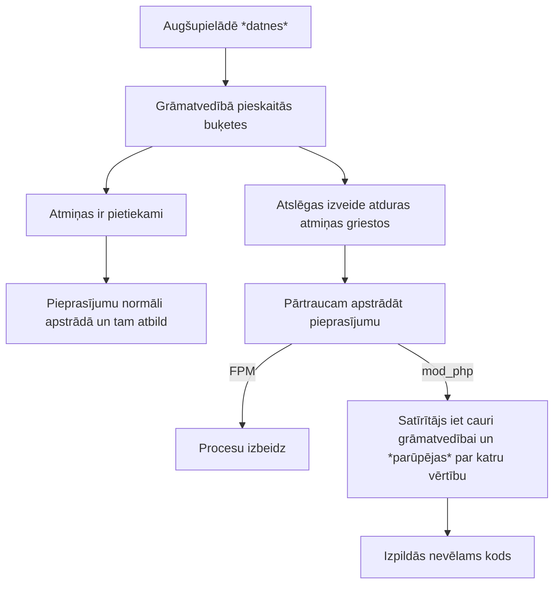

# php2shell

2026. gada 21. novembrī tika [izziņotas](https://www.php.net/archive/2026.php#2026-10-21-5)
PHP ievainojamības un izlaisti to labojumi.

Daudz kas tika izslēgts. Un daudz kas nestrādāja.

## Ievainojamības

| | [CVE-2026-109618](https://github.com/php/php-src/security/advisories/GHSA-w8hw-w9fx-j79w) | [CVE-2026-109619](https://github.com/php/php-src/security/advisories/GHSA-6wmf-4rv5-p3rp) |
|-------:|------|-------------|
| nosaukums | RCE via OOM corruption | RCE via stale global state |
| uzbrukumi skar | Apache + mod_php | mod_php, PHP-FPM |
| izmantojamība | noklusējuma konfigurācija <br> neatkarīgi no koda | atkarībā no koda |

> [!NOTE]
> FrankenPHP, LSAPI — nav zināms.

### RCE via OOM corruption

- **Pieņēmums:** Visas zināmās struktūras ir "gatavas" un drošas.
- **Kļūda**: Beidzoties atmiņai darbu pārtrauc pusratā.
- **Problēma**: Atmiņas satīrītājs nejauši izpilda kodu.

Uzbrukumu ieskicēsim pēc Calif [raksta](https://calif.io/php2shell/).
PHP masīva

```php
[
    'vārds' => 'Pēteris',
    'uzvārds' => 'Paraugs',
    'adrese' => [
        'iela' => 'Piemēra iela',
        'pilsēta' => 'R1ga',
    ],
    'pazīmes' => [
        'pieklājīgs',
        'pacietīgs',
    ],
];
```

elementi [tiek glabāti](https://github.com/php/php-src/blob/82b01e22298a49033f4c651ed60a73b7bb4986c9/Zend/zend_types.h#L386-L418) šādās C buķetēs:

```c
typedef struct _Bucket {
	zval              val;
	zend_ulong        h;                /* hash value (or numeric index)   */
	zend_string      *key;              /* string key or NULL for numerics */
} Bucket;
```

bet [veidojot tās](https://github.com/php/php-src/blob/82b01e22298a49033f4c651ed60a73b7bb4986c9/Zend/zend_hash.c#L1064) varēja pārtrūkt darbs:

```php
// https://calif.io/php2shell/#but-what-does-an-oom-buy-you-really
idx = ht->nNumUsed++;
ht->nNumOfElements++;

p = ht->arData + idx;
p->key = zend_string_init(str, len, persistent); /* may zend_bailout() */

p->h = ZSTR_H(p->key) = h;
ZVAL_COPY_VALUE(&p->val, pData);
```

`key` paliek nesagatavots — kas tur iekšā?

Bet grāmatvedībā (`nNumUsed`, `nNumOfElements`) jau pieskaitīts un satīrītājs ķersies klāt — tur tad arī var notikt nevēlama koda izpilde, ja `p->key` iedalītajā vietā ir palikuši baiti, kurus satīrītājs interpretēs kā kaut ko izpildāmu. (Kāpēc? Kā tur dabūt tādus baitus?)

**Kā pārsniedz atmiņu?** No [paziņojuma](https://github.com/php/php-src/security/advisories/GHSA-w8hw-w9fx-j79w):

- A multipart request without a usable declared content length may pass the initial `post_max_size` check and continue supplying decoded body data. **IZLABOTS**
- A multipart part can contain an unrestricted number of headers. Representing these headers inside PHP can use substantially more memory than their wire representation, allowing a request within `post_max_size` to exhaust the normal `memory_limit`. **IZLABOTS**
- Empty file controls do not count towards `max_file_uploads` but still create the normal file metadata arrays. Nested field names multiply the generated array work.

Piemēram, lauka `pacients[316][adrese][iela]` iesūtīšana aizņem atmiņu ar struktūru:

```php
[
    'pacients' => [
        316 => [
            'adrese' => [
                'iela' => /* ..... */,
            ],
        ],
    ],
];
```



> [!CAUTION]
> **Kļūda** bija visiem (ir **IZLABOTA**), bet izmantojamība atrasta tikai mod_php. Atkarīga no konfigurācijas, paplašinājumiem.

> [!TIP]
> Tāpēc drošāk ir neizpaust info par serveri (versijas, `phpinfo()`).

### RCE via stale global state

## Hronoloģija

## Ko vajadzēja darīt?

## Iespējas atjaunot

- veci projekti

- sarežģīti projekti

- debian / ubuntu
- redhat / centos
- docker


## Kā būt drošākiem

kā pasargāties?
- izolēti serveri
- readonly konteineri, datubāzes pieslēgumi
- apparmor


izolēts
ierobežots
readonly

## Ko tas saka par PHP?


citi arī bija ievainojami...


